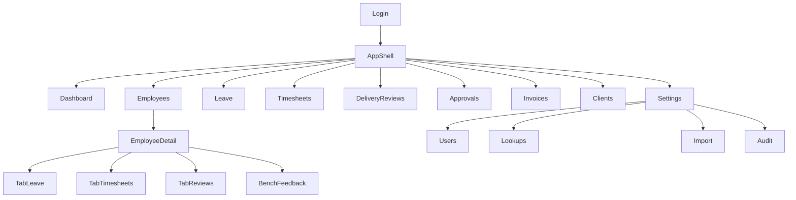

# Information Architecture & Navigation — CDT

## Purpose

Define IA, primary navigation, and information hierarchy for the CDT SPA.

## Audience

UX, frontend engineers.

## Scope

Shipped screens. Future nav items stay hidden.

## Definitions

| Term | Definition |
|------|------------|
| Shell | App chrome: nav, header, cost-center filter, search, user menu |
| Route module | Feature area under React Router |

---

## 1. Sitemap

## 2. Primary navigation

| Item | Route | Roles |
|------|-------|-------|
| Dashboard | `/dashboard` | All authenticated |
| Employees | `/employees` | All (mutate: ADMIN, DELIVERY_OWNER) |
| Leave | `/leave` | All |
| Timesheets | `/timesheets` | All |
| Delivery Reviews | `/delivery-reviews` | All |
| Approvals | `/approvals` | ADMIN, ACCOUNT_OWNER |
| Invoices | `/invoices` | All |
| Clients | `/clients` | All |
| Settings | `/settings/*` | ADMIN |

## 3. Shell filters

- **Cost center:** All / BrickRed / Agyom  
- **Search:** employees and clients  

## 4. Employee detail hierarchy

1. Identity & category fields  
2. Bench block (if BENCH): aging, interviews scheduled/cleared, feedback timelines  
3. Tabs: Leave · Timesheets · Reviews (billable workflows)  

## References

- [../09-frontend/FEATURE_MODULES.md](../09-frontend/FEATURE_MODULES.md)
- [../09-frontend/AUTH_AND_ROUTING.md](../09-frontend/AUTH_AND_ROUTING.md)
