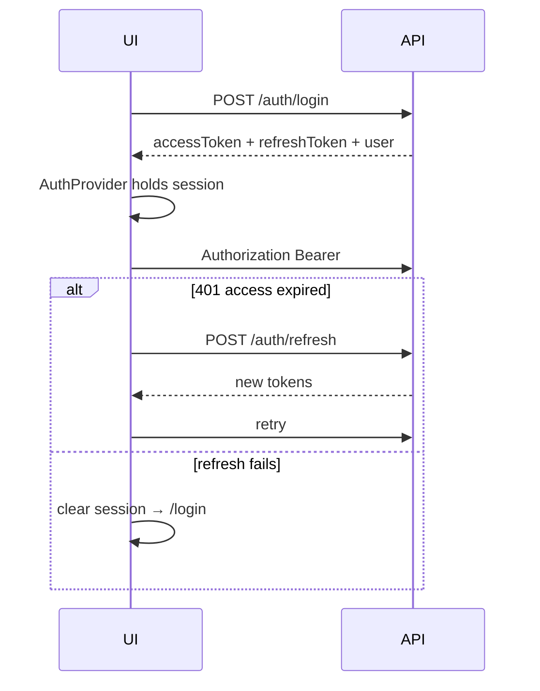

# Auth & Routing — CDT Web

## Purpose

Define SPA authentication session handling and route protection for CDT roles.

## Audience

Frontend engineers, security reviewers.

## Scope

JWT access + refresh with React Router. SSO is Future.

## Definitions

| Term | Definition |
|------|------------|
| Access token | Short-lived JWT held by AuthProvider |
| Refresh token | Rotated body token; hashed server-side |
| Protected route | Requires `accessToken`; else redirect `/login` |

---

## 1. Session lifecycle



## 2. AuthProvider responsibilities

| Duty | Detail |
|------|--------|
| Login/logout | Mutations + cache clear |
| Expose | `user`, `accessToken`, role helpers |
| Axios | Attach Bearer; refresh on 401 |

## 3. Routing structure (`App.tsx`)

```text
/login
/dashboard
/employees
/employees/:id
/leave
/timesheets
/delivery-reviews
/approvals
/invoices
/clients
/settings/users
/settings/lookups
/settings/audit
/settings/import
```

Redirects: `/` → `/dashboard`, `/candidates` → `/employees`, `/leaves` → `/leave`.

```mermaid
flowchart TB
  Req[Request route]
  Authed{Authenticated?}
  Login[/login]
  Page[Feature page]
  Req --> Authed
  Authed -->|no| Login
  Authed -->|yes| Page
```

Fine-grained **action** gates live on each page (not separate route trees per role).

## 4. Role → default landing

| Role | Landing |
|------|---------|
| `ADMIN` | `/dashboard` |
| `DELIVERY_OWNER` | `/dashboard` |
| `ACCOUNT_OWNER` | `/dashboard` (Approvals for workflow) |

## 5. Nav visibility (UX only)

| Nav item | ADMIN | DELIVERY_OWNER | ACCOUNT_OWNER |
|----------|-------|----------------|---------------|
| Dashboard | Y | Y | Y |
| Employees | Y | Y | Y |
| Leave | Y | Y | Y |
| Timesheets | Y | Y | Y |
| Delivery Reviews | Y | Y | Y |
| Approvals | Y | — | Y |
| Invoices | Y | Y | Y |
| Clients | Y | Y | Y |
| Settings | Y | — | — |

Authoritative matrix: [../11-security/PERMISSION_MATRIX.md](../11-security/PERMISSION_MATRIX.md).

## 6. Deep links & public IDs

Employee detail accepts UUID or `CD-#####`. API resolves either.

## References

- [FEATURE_MODULES.md](./FEATURE_MODULES.md)
- [../11-security/AUTH_RBAC.md](../11-security/AUTH_RBAC.md)
