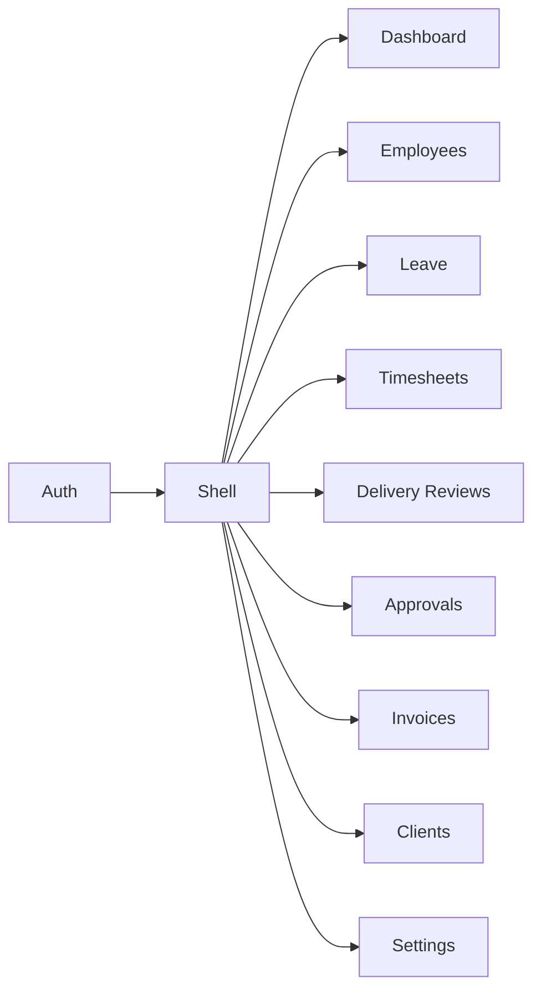

# Feature Modules — CDT Web

## Purpose

Catalog SPA feature areas, primary screens, and their API dependencies.

## Audience

Frontend engineers, UX implementers, QA.

## Scope

Shipped screens aligned to Employees → Leave / Timesheet → Delivery Review → Approvals → Invoices → Dashboard.

## Definitions

| Term | Definition |
|------|------------|
| Screen | Routable page under `apps/web/src/pages/` |
| Action | Button/mutation gated by role |

---

## Feature map

| Feature | Routes | Primary roles | API |
|---------|--------|---------------|-----|
| auth | `/login` | Public | `/auth/*` |
| dashboard | `/dashboard` | All | `/dashboard/*` |
| employees | `/employees`, `/employees/:id` | All (mutate: ADM/DO) | `/candidates/*` |
| leave | `/leave` | All (approve: ADM/AO) | `/leaves/*` |
| timesheets | `/timesheets` | All (approve: ADM/AO) | `/timesheets/*` |
| delivery reviews | `/delivery-reviews` | All (upsert: ADM/DO) | `/delivery-reviews/*` |
| approvals | `/approvals` | ADM, AO | pending leaves/TS |
| invoices | `/invoices` | All (lifecycle: ADM/AO) | `/invoices/*` |
| clients | `/clients` | All (mutate: ADM/DO) | `/clients/*` |
| settings users | `/settings/users` | ADMIN | `/users/*` |
| settings lookups | `/settings/lookups` | ADMIN | `/lookups/*` |
| settings audit | `/settings/audit` | ADMIN | `/audit` |
| settings import | `/settings/import` | ADMIN | `/import/*` |

Aliases: `/candidates` → `/employees`, `/leaves` → `/leave`.

---

## Employees (categories)

| Category | Purpose | Notable fields |
|----------|---------|----------------|
| BILLABLE | Client deployment | Client, billing, sales/account owners |
| NON_BILLABLE | Internal teams | Team (`SUPPORT`/`LEADERSHIP`/`DELIVERY`), support function |
| BENCH | Between placements | Bench start, interviews scheduled/cleared, DM/AM feedback timelines |

Timesheets, invoices, and delivery reviews are **billable-only**.

---

## Shell concerns

- Cost-center filter: `ALL` / `BRICKRED` / `AGYOM`  
- Global search (employees/clients)  
- Branding from selected cost center  

---

## References

- [AUTH_AND_ROUTING.md](./AUTH_AND_ROUTING.md)
- [../11-security/PERMISSION_MATRIX.md](../11-security/PERMISSION_MATRIX.md)
- [../21-guides/CDT_BUSINESS_FEATURE_GUIDE.md](../21-guides/CDT_BUSINESS_FEATURE_GUIDE.md)
