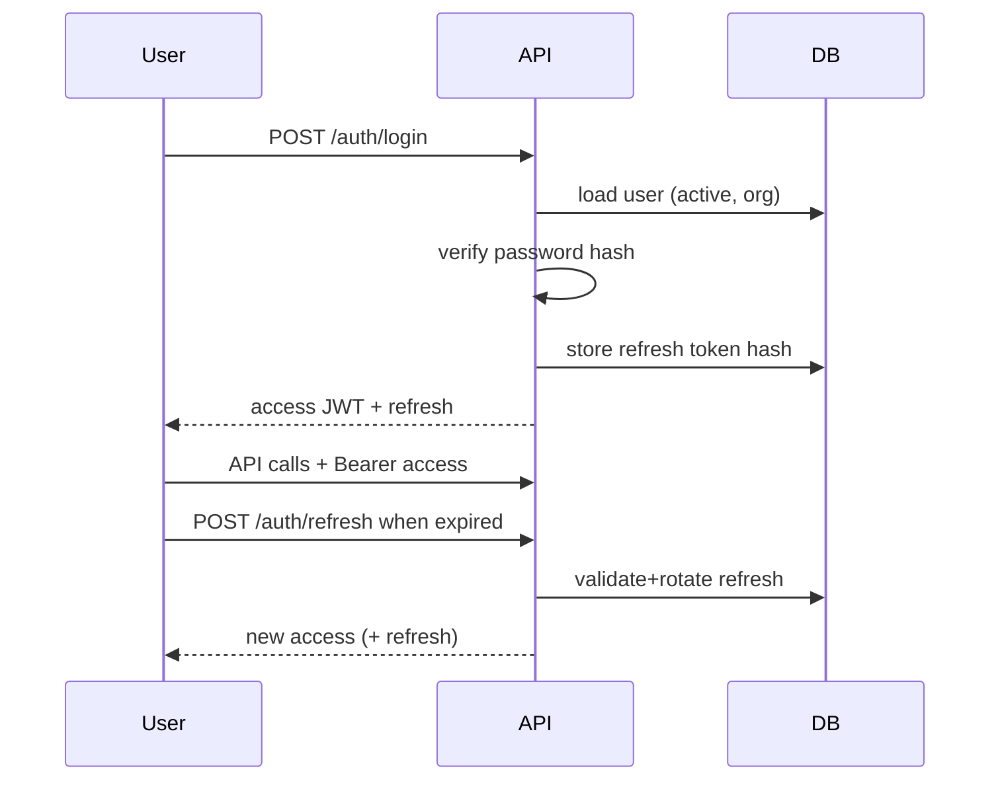

# Auth & RBAC — CDT

## Purpose

Define authentication, session/token handling, and role-based access control for the shipped CDT application.

## Audience

Backend, frontend, security, QA.

## Scope

Local accounts with JWT access + refresh. SSO/OIDC and fine-grained ABAC remain Future.

## Definitions

| Term | Definition |
|------|------------|
| AuthN | Prove identity |
| AuthZ | Permit action |
| RBAC | Role-based access control |
| Soft release | Domain status on an employee (`RELEASED`); still requires authZ to invoke |
| Cost center | `BRICKRED` or `AGYOM` filter on clients/employees (not a separate login tenant) |
| Organization | Single company tenant (`brickred`); users and data are scoped by `organizationId` |

### Roles (Prisma `Role`)

| Role | Intent |
|------|--------|
| `ADMIN` | Full control: users, lookups, audit, import, all domain |
| `DELIVERY_OWNER` | Delivery ops: employees, clients, timesheet entry, delivery reviews, generate invoices, dashboard |
| `ACCOUNT_OWNER` | Approvals: leave/timesheet approve/reject, invoice review (approve/send/paid/reject), dashboard |

> **Naming note:** UI may say Delivery Manager / Account Manager. API and database enums are `DELIVERY_OWNER` / `ACCOUNT_OWNER`. Bench feedback kinds still use `DELIVERY_MANAGER` / `ACCOUNT_OWNER` as timeline labels.

---

## 1. Authentication flow



### Tokens

| Token | Lifetime | Storage (SPA) |
|-------|----------|---------------|
| Access JWT | `JWT_ACCESS_TTL` (default `15m`) | Memory / app state |
| Refresh | `JWT_REFRESH_TTL` (default `7d`) | App storage; hashed at rest in DB |

JWT claims (minimal): `sub` (user id), `role`, `email`, `organizationId`, `iat`, `exp`.

Password hashing: bcrypt.

## 2. Authorization model

1. Authenticate via JWT guard  
2. Authorize via `@Roles` on route  
3. Apply domain rules in service (released employee, category gates, client ownership scope)  
4. UI gates are non-authoritative  

```text
Request → JwtAuthGuard → RolesGuard → Controller → Service policy / client-scope checks
```

### Client ownership scoping

- Clients can list **Delivery Owners** and **Account Owners**.
- Non-admin owners may only see employees/clients in their ownership / cost-center scope as enforced by `client-scope` helpers.

## 3. Role summaries

| Capability area | ADMIN | DELIVERY_OWNER | ACCOUNT_OWNER |
|-----------------|-------|----------------|---------------|
| Users / lookups / audit / import | Full | — (users list for assign) | — |
| Clients mutate | Yes | Yes | Read |
| Employees mutate / release / bench feedback | Yes | Yes | Read |
| Leave create | Yes | Yes | Read |
| Leave approve / reject | Yes | — | Yes |
| Timesheet upsert | Yes | Yes | Read |
| Timesheet approve / reject | Yes | — | Yes |
| Delivery review upsert | Yes | Yes | Read |
| Invoices generate | Yes | Yes | Yes |
| Invoices approve / send / paid / reject | Yes | — | Yes |
| Dashboard / search | Yes | Yes | Yes |

Full matrix: [PERMISSION_MATRIX.md](./PERMISSION_MATRIX.md).

## 4. Public routes

| Route | Reason |
|-------|--------|
| `POST /api/v1/auth/login` | Obtain session |
| `POST /api/v1/auth/refresh` | Rotate session |
| `GET /health` | Probes |
| `/api/docs` | Swagger (lock down in hardened prod) |

## 5. Account lifecycle

| Action | Rules |
|--------|-------|
| Create user | ADMIN; unique email per organization; role one of the three |
| Disable | `isActive=false` → login denied |
| Soft delete | Optional; treat like disable |

## 6. Threat-oriented controls

| Threat | Control |
|--------|---------|
| Credential stuffing | Rate-limit login (ops); strong seed passwords rotated |
| XSS token theft | Short access TTL; careful SPA storage |
| Stolen refresh | Hash at rest; rotate; revoke on logout |
| Privilege escalation | Server role from DB; don’t trust client role field |
| CSRF / CORS | `CORS_ORIGIN` allowlist to SPA origin |

## MVP vs Future

| Topic | Shipped | Future |
|-------|---------|--------|
| Local passwords | Yes | SSO/OIDC |
| Three-role RBAC | Yes | Finer ABAC |
| MFA | No | For ADMIN |

## References

- [PERMISSION_MATRIX.md](./PERMISSION_MATRIX.md)
- [OWASP_AND_SECRETS.md](./OWASP_AND_SECRETS.md)
- [../10-api/API_CATALOG.md](../10-api/API_CATALOG.md)
