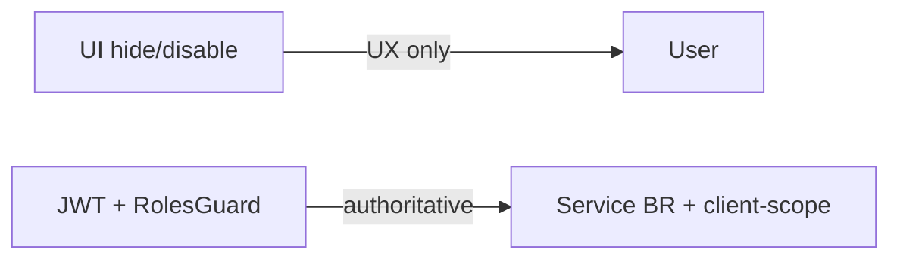

# Permission Matrix — CDT

## Purpose

Map roles to operations for Nest Guards, service checks, and UI gates.

## Audience

Backend, frontend, security, QA.

## Scope

Shipped roles: `ADMIN`, `DELIVERY_OWNER`, `ACCOUNT_OWNER`.

## Definitions

| Code | Meaning |
|------|---------|
| C | Create |
| R | Read |
| U | Update |
| D | Soft-delete / disable / release |
| A | Approve / reject / invoice lifecycle actions |
| — | Denied |

Abbreviations: **ADM**, **DO** (`DELIVERY_OWNER`), **AO** (`ACCOUNT_OWNER`).

---

## Matrix (API)

| Resource / Action | ADM | DO | AO |
|-------------------|-----|----|----|
| Auth me / logout / refresh | R | R | R |
| Users manage (CRUD) | CRUD | R (assign lists) | — |
| Lookups read | R | R | R |
| Lookups mutate | CRUD | — | — |
| Clients create/update | CU | CU | — |
| Clients read | R | R | R |
| Clients soft-delete | D | D | — |
| Employees create/update | CU | CU | — |
| Employees read | R | R | R |
| Employees release / delete | D | D | — |
| Bench feedback add | C | C | C (detail) |
| Leave create / update Pending | CU | CU | — |
| Leave read | R | R | R |
| Leave approve / reject | A | — | A |
| Timesheets read | R | R | R |
| Timesheets upsert | CU | CU | — |
| Timesheets approve / reject | A | — | A |
| Delivery reviews read | R | R | R |
| Delivery reviews upsert | CU | CU | — |
| Invoices generate | C | C | C |
| Invoices read | R | R | R |
| Invoices approve / send / paid / reject | A | — | A |
| Dashboard read | R | R | R |
| Search | R | R | R |
| Audit logs read | R | — | — |
| Import dry-run / commit | C | — | — |

**Source alignment:** Account Owner owns leave/timesheet approval and invoice review. Delivery Owner owns employees, timesheet entry, delivery reviews, and can generate invoices from approved timesheets.

### Clarified leave actions

| Action | ADM | DO | AO |
|--------|-----|----|----|
| Create / patch Pending | Y | Y | — |
| Approve | Y | — | Y |
| Reject | Y | — | Y |

### Clarified timesheet actions

| Action | ADM | DO | AO |
|--------|-----|----|----|
| Create / update Pending | Y | Y | — |
| Approve | Y | — | Y |
| Reject | Y | — | Y |

### Invoice actions

| Action | ADM | DO | AO |
|--------|-----|----|----|
| Generate (from approved TS) | Y | Y | Y |
| Approve / reject / mark sent / mark paid | Y | — | Y |

---

## UI navigation gates

| Nav / Screen | ADM | DO | AO |
|--------------|-----|----|----|
| Dashboard | Y | Y | Y |
| Employees | Y | Y | Y |
| Leave | Y | Y | Y |
| Timesheets | Y | Y | Y |
| Delivery Reviews | Y | Y | Y (read) |
| Approvals | Y | — | Y |
| Invoices | Y | Y | Y |
| Clients | Y | Y | Y |
| Settings → Users | Y | — | — |
| Settings → Lookups | Y | — | — |
| Settings → Audit | Y | — | — |
| Settings → Import | Y | — | — |

---

## Row / domain rules (beyond role)

| Rule | Enforcement |
|------|-------------|
| Released employee | Block new leave/timesheet/review creates |
| Category gates | Timesheets, invoices, delivery reviews only for **ACTIVE + BILLABLE** |
| Leave status machine | Invalid transitions → 400 |
| One TS / one DR per employee+month; one invoice per timesheet | Unique + 409 |
| Escalation notes | Required when health=`ESCALATED` |
| Approved leave only | Timesheet leave-day calc |
| Invoice generation | Requires approved timesheet + billing fields |
| Bench interviews | `interviewsClearedCount` ≤ `interviewsScheduledCount` |
| Cost center filter | Shell filter + API `costCenter` query |

---

## Enforcement

UI never sole control.

## References

- [AUTH_RBAC.md](./AUTH_RBAC.md)
- [../10-api/API_CATALOG.md](../10-api/API_CATALOG.md)
- [../09-frontend/AUTH_AND_ROUTING.md](../09-frontend/AUTH_AND_ROUTING.md)
